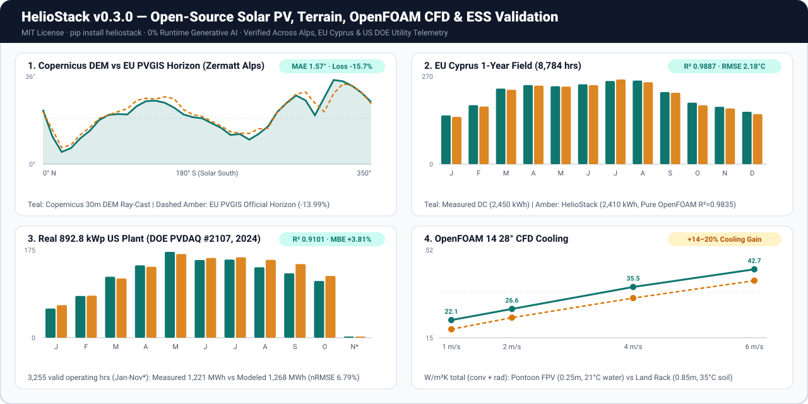

# HelioStack `v0.3.1`

[](https://github.com/ttthkim-hue/heliostack/actions/workflows/ci.yml)
[](https://github.com/ttthkim-hue/heliostack/actions/workflows/openfoam-ci.yml)
[](https://pypi.org/project/heliostack/)
[](./LICENSE)
[](https://ttthkim-hue.github.io/heliostack/)
[](./AI_DISCLOSURE.md)
[](https://orcid.org/0009-0003-5047-7501)

**Freeing solar PV + battery storage engineering from closed commercial silos (`PVsyst`, `PV*SOL`, `HOMER Pro`, `HelioScope`) with an `AGPL-3.0-or-later` Python, OpenFOAM & open-standards workbench—built to empower individuals, citizen energy communities, small installers, graduate researchers, and open energy labs.**  
Clean-room `.PAN`/`.OND` checks · Copernicus DEM alpine horizon · OpenFOAM 14 CFD cooling · Dual-continent field telemetry · 8,760-hr HiGHS `LiFePO4` dispatch · `RO-Crate 1.1` provenance · Zero-install browser execution.

```bash
pip install heliostack
```

> **Try Live Offline Simulator in Browser:** https://ttthkim-hue.github.io/heliostack/



> **Key Counter-Intuitive Physics Finding (Verified Open):** Pontoon Floating PV drops daytime cell temperatures by `-3.59 °C` to `-5.77 °C` (`+14–20%` total heat rejection in OpenFOAM 14 `28°` CFD), **yet** dark water albedo (`0.08` vs land `0.20`) reduces rear-side bifacial gain—delivering net annual yield gains in hot climates (**Seville `+0.38%`**) while flipping slightly negative in cooler Northern Europe (**Amsterdam `-0.68%`**).

- **Verified Data, CFD & Dual-Continent Telemetry:**
  1. **EU PVGIS v5.3** (`SARAH3` & `ERA5`) hourly TMY & `PVcalc` cross-validation across 4 baseline climates (`POA -0.59%` to `+2.74%`)
  2. **Copernicus DEM** 36-azimuth ray-cast terrain horizon vs EU PVGIS `printhorizon` across Innsbruck, Bolzano, and Zermatt (`MAE 1.25–1.57°`)
  3. **OpenFOAM 14 (`foamRun -solver fluid`, steady `kOmegaSST`)** `28°`-tilted PV sweep (`5,910` cells, 8 cases) calibrating land vs pontoon Floating-PV cooling
  4. **European Union 1-Year Outdoor Testbed** (**University of Cyprus PHAETHON CoE**, `8,784` full hours, `CC-BY-4.0`): `Tmod RMSE 2.18 °C` (`open_rack R² 0.9705`) / `4.19 °C` (`OpenFOAM 14 R² 0.8906`), full-year DC `R² 0.9887`
  5. **Real 892.8 kWp US Utility Telemetry** (**US DOE / NREL PVDAQ #2107**, 2024 `3,255` daylight operating hours, `R² = 0.9101`, `MBE = +3.81%`, `nRMSE = 6.79%`)
  6. **Canonical `pvlib ModelChain` parity** (`-0.67%` Amsterdam, `+0.31%` Seville) + 12-step PVsyst-style loss tree
- **AI Transparency:** [`AI_DISCLOSURE.md`](./AI_DISCLOSURE.md) | **NLnet `2027-01-03` Roadmap:** [`docs/ROADMAP_TO_NLNET_20270103.md`](./docs/ROADMAP_TO_NLNET_20270103.md)

---

## Why HelioStack? Open Internet Stack & Citizen Energy Democratization

The clean-energy transition does not scale through utilities and national governments alone—it accelerates when **individuals, households, citizen energy cooperatives, local installers, and independent labs** can simulate, audit, and size distributed solar PV + storage infrastructure on their own terms.

Today, that capability is gated behind Windows-only proprietary binaries (`PVsyst`, `PV*SOL`, `HOMER Pro`) and closed cloud SaaS (`HelioScope`) that lock equipment definitions inside vendor silos and keep site data on third-party servers, while open libraries (`pvlib`) leave a steep gap between low-level irradiance math and end-to-end site shading, CFD thermal balances, `LiFePO4` curtailment recovery, and bankable audit bundles.

`HelioStack` brings **Open Internet Stack** principles—open protocols, local data sovereignty, zero-install web accessibility, and anti-enclosure licensing—to distributed solar engineering:

1. **Democratizing Bankable Simulation Beyond Large Enterprises:** Citizens, community microgrids, and small installers get the same `.PAN`/`.OND` invariant checks, Copernicus DEM mountain-horizon shading, thermal physics, and sparse 8,760-hour `LiFePO4` dispatch LP used by large engineering firms—free of per-seat licenses or proprietary cloud lock-in.
2. **Local Data Sovereignty & Zero-Install Browser Path:** `HelioStack` runs **100% deterministically on CPU** (`0%` generative AI at runtime). Its [offline interactive browser workbench](https://ttthkim-hue.github.io/heliostack/) already executes client-side with zero backend telemetry, and the `v1.0` roadmap expands this into a full client-side **WebAssembly / WebGL** CAD & household/community sizing tool.
3. **Clean-Room Equipment Validation (`.PAN` / `.OND` / JSON):** Enforces physical single-diode & MPPT window invariants (`Vmp < Voc`, `Imp < Isc`, finite metrics, inverter efficiency bounds) over open schemas.
4. **Vectorized 3D Ray-Box, Copernicus DEM & Diffuse SVF:** Evaluates 3D obstacle shading, Copernicus 30m satellite & ASCII ESRI `.asc` DEM 36-azimuth mountain horizon blocking, inter-row shed geometry, and cosine-weighted hemispherical sky-view factors.
5. **Thermal Physics Beyond Single U-Values:** Compares open-rack Faiman baselines against wind-angle convective alleys and lagged water-coupled Floating-PV cooling (`-3.59 °C` to `-5.77 °C` daytime cooling), calibrated via reproducible OpenFOAM 14 runs.
6. **8,760-Hour Sparse HiGHS `LiFePO4` Dispatch LP:** Quantifies curtailment recovery under grid export caps with ESS container HVAC auxiliary loads and strict `10^-6 kW` hourly conservation checks.
7. **Verifiable Open Provenance (`RO-Crate 1.1` + `SHA-256`):** Outputs byte-deterministic `RO-Crate 1.1` (`ro-crate-metadata.json`), `repro-manifest.json` (`SHA-256`), and zero-CDN `bankable_report.html` so any citizen cooperative, lender, or peer reviewer can verify every input and number offline.

---

## Observed 4-Site EU PVGIS v5.3 Benchmark (`100 kWp`, Verified Offline)

| Location (PVGIS DB) | POA Delta vs PVcalc | Mono Yield vs PVcalc | Land Bifacial (PR) | Floating PV Cooling (Pure Thermal / Net Bifacial) | 3D Obstacle Shade | 65% Cap + 200 kWh ESS Recovery (LP Time) |
| :--- | :---: | :---: | :---: | :---: | :---: | :---: |
| **Amsterdam, NL** (`SARAH3`) | `-0.59%` | `1083.5` vs `1071.6` (`+1.11%`) | `1100.7 kWh/kWp` (`87.3%`) | `-3.59 °C` (`+1.53%` / `-0.68%`) | `15.07%` | `100.0%` of `6,205 kWh` (`0.70 s`) |
| **Munich, DE** (`SARAH3`) | `-1.12%` | `1204.4` vs `1191.5` (`+1.08%`) | `1234.5 kWh/kWp` (`87.2%`) | `-4.30 °C` (`+1.96%` / `-0.22%`) | `13.88%` | `100.0%` of `8,297 kWh` (`0.73 s`) |
| **Seville, ES** (`SARAH3`) | `-1.12%` | `1814.9` vs `1747.8` (`+3.84%`) | `1876.6 kWh/kWp` (`86.3%`) | `-5.77 °C` (`+2.30%` / `+0.38%`) | `11.24%` | `100.0%` of `19,449 kWh` (`0.73 s`) |
| **Busan, KR** (`ERA5`) | `+2.74%` | `1640.1` vs `1550.0` (`+5.82%`) | `1693.2 kWh/kWp` (`89.5%`) | `-4.16 °C` (`+1.53%` / `-0.39%`) | `11.63%` | `100.0%` of `14,690 kWh` (`0.79 s`) |

---

## Phase 2 Validation Highlights (`v0.2.0`)

### 1. Alpine Terrain Shading (Horizon-Free TMY + Sky-Dome SVF)
| Alpine Valley | Elevation | Copernicus vs PVGIS MAE | Flat -> Copernicus Loss | EU PVcalc Terrain Loss | Copernicus vs PVGIS-Hor Delta |
| :--- | :---: | :---: | :---: | :---: | :---: |
| **Innsbruck, AT** | `580 m` | `1.28°` | `1537.4 -> 1504.7` (`-2.13%`) | `-1.53%` | `+0.46%` |
| **Bolzano, IT** | `271 m` | `1.25°` | `1624.5 -> 1545.3` (`-4.88%`) | `-4.86%` | `+2.28%` |
| **Zermatt, CH** | `1,610 m` | `1.57°` | `1645.8 -> 1387.2` (`-15.72%`) | `-13.99%` | `+1.98%` |

### 2. Real Utility Meter Telemetry (`US DOE / NREL PVDAQ #2107`, Arbuckle, CA — 2024 Jan–early Nov)
- Plant: `892.8 kWp DC` (`2,880 × 310 W`), `24 × 27.6 kW` (`662.4 kW AC`), 7-year aging factor `0.965`, `3,255` daylight operating hours.
- **Convective Land Model:** Measured `1,221.32 MWh` vs Modeled `1,267.82 MWh` | **`MBE = +3.81%`**, **`nRMSE = 6.79%`**, **`R² = 0.9101`**.
- **Open-Rack Faiman Baseline:** Measured `1,221.32 MWh` vs Modeled `1,268.83 MWh` | `MBE = +3.89%`, `nRMSE = 6.80%`, `R² = 0.9098`.

### 3. Canonical `pvlib ModelChain` Parity (`99.0 kWp` Mono Plant)
- **Amsterdam, NL:** `pvlib = 1,113.34` vs `HelioStack = 1,105.87 kWh/kWp` (**`-0.67%`**)
- **Seville, ES:** `pvlib = 1,846.44` vs `HelioStack = 1,852.10 kWh/kWp` (**`+0.31%`**)

---

## Phase 3 Validation (`v0.3.1`): OpenFOAM 14 CFD & European Full-Year Field Testbed

### 1. Reproducible OpenFOAM 14 `28°`-Tilted PV Thermal Sweep (`foamRun -solver fluid`, 5,910 cells)
| Mounting Surface | Clearance / Soil or Water Boundary | Wind Convective Fit (`h_conv(v)`) | Longwave `h_rad` | OpenFOAM Faiman Eq. (`u0`, `u1`) |
| :--- | :---: | :---: | :---: | :---: |
| **Land Rack** | `0.85 m` over `+35 °C` sunlit soil | `4.705 + 3.648·v W/m²K` | `11.738 W/m²K` | `u0 = 22.56`, `u1 = 5.00` |
| **Floating PV** | `0.25 m` over `+21 °C` reservoir water | `4.912 + 3.906·v W/m²K` | `14.688 W/m²K` | `u0 = 26.89`, `u1 = 5.36` |

### 2. European Union 1-Year Field Validation (University of Cyprus PHAETHON CoE, `8,784` hrs, `CC-BY-4.0`)
- Dataset: June 2015 – May 2016 (`3,935` daylight operating hours, DOI `10.5281/zenodo.10816826`).
- **Thermal Accuracy (`Tmod` backsheet PT100):** `open_rack` `RMSE = 2.18 °C` (`R² = 0.9705`), `convective_land` `RMSE = 2.22 °C` (`R² = 0.9693`), pure **OpenFOAM 14 `cfd_land`** (zero Cyprus tuning) `RMSE = 4.19 °C` (`R² = 0.8906`).
- **Full-Year Yield Accuracy:** Measured `2,450 kWh` DC vs Modeled `2,410 kWh` (`MBE = -1.62%`, `nRMSE = 2.85%`, `R² = 0.9887`; AC `MBE = -1.01%`, `R² = 0.9876`).

---

## Live Interactive Workbench

- **Browser Simulator (Zero Server Required):** https://ttthkim-hue.github.io/heliostack/

---

## How HelioStack Complements Existing Open-Source Tools

| Existing Open Tool | Primary Focus | What Remains Unsolved End-to-End |
| :--- | :--- | :--- |
| **`pvlib-python`** (used inside HelioStack) | Low-level solar position, transposition & single-diode math | Unified `.PAN`/`.OND` validation + 3D shading + Copernicus horizon + CFD thermal + HiGHS ESS + `RO-Crate 1.1` audit |
| **`NREL / SAM`** | Desktop GUI simulator for US policies & buildings | Lightweight Python/CLI microservice, browser WASM/WebGL path, Copernicus EU horizon, OpenFOAM FPV cooling, cryptographic bundles |
| **`open-pv / simshady`** | Browser JavaScript 3D shadow casting | Bankable 8,760-hr energy loss tree, single-diode electrical yield & ESS optimization |
| **`PyPSA` / `oemof`** | Macro grid / national transmission LP optimization | Site-level PVsyst-grade `.PAN`/`.OND` single-diode modeling, 3D/DEM shade & micro-thermal physics |
| **`Bifacial_Radiance`** | Radiance backward ray-tracing optics | Fast CPU engineering workbench integrating thermal CFD, ESS curtailment LP & `RO-Crate 1.1` provenance |

---

## Quick Start

```bash
# Option A: Install from PyPI (recommended) or directly from GitHub tag
pip install heliostack
pip install "git+https://github.com/ttthkim-hue/heliostack.git@v0.3.1"

# Option B: Editable developer install
git clone https://github.com/ttthkim-hue/heliostack.git
cd heliostack
pip install -e ".[dev]"

# 1. Validate .PAN / .OND specifications (exit 0 on valid, exit 1 on physics failure)
heliostack validate fixtures/equipment/ref_550w_bifacial.pan
heliostack validate fixtures/equipment/invalid_module.pan

# 2. Extract 36-azimuth Copernicus DEM terrain horizon vs EU PVGIS printhorizon
heliostack horizon --lat 47.2692 --lon 11.4041 --cache-dir fixtures/weather

# 3. Run full Phase 1 + Phase 2 + Phase 3 reproducible benchmarks
python benchmarks/run_europe_benchmark.py
python benchmarks/run_phase2_validation.py
python benchmarks/run_phase3_validation.py

# (Optional in WSL2 / Linux with OpenFOAM 14 installed):
python openfoam/run_openfoam_pv_sweep.py

# 4. Preview offline interactive Web UI locally
heliostack serve --dir docs --port 8780
```

---

## Author & Verified Open-Science Track Record

`HelioStack` is created and maintained by **Tae-Hyung Kim** ([ORCID `0009-0003-5047-7501`](https://orcid.org/0009-0003-5047-7501) · [GitHub `@ttthkim-hue`](https://github.com/ttthkim-hue) · M.S. Materials Engineering, Pusan National University `2025`; B.S. Materials Engineering, University of Ulsan `2020`).

- **Companion Open-Source CFD & Reproducibility Software:**
  - [`taichi_lbm_ref_gyroid`](https://github.com/ttthkim-hue/taichi_lbm_ref_gyroid) — GPU-accelerated (`Taichi`) D3Q19 MRT Lattice Boltzmann Method (MRT-LBM) porous-media CFD solver with Bayesian Optimization (`50`-point Pareto front, Forchheimer regression, OpenSCAD/STL/STEP CAD exchange).
  - [`openfair-mat`](https://github.com/ttthkim-hue/openfair-mat) — `MIT`-licensed pure Python standard-library physical-integrity, schema, and `RO-Crate 1.1` + `SHA-256` reproducibility validator (`openfair-check`) for open scientific datasets (Zenodo, NOMAD FAIRmat, Materials Project).
- **Peer-Reviewed Research Record:** `14` peer-reviewed journal articles indexed on [ORCID `0009-0003-5047-7501`](https://orcid.org/0009-0003-5047-7501) (`7` sole first-author, `1` co-first author, `6` co-author), plus `1` 2022 Crossref/OpenAlex-verified co-authored article (`15` total), including:
  - **First Author (2026):** *Self-powered triboelectric electrospun air filters as functional fibrous materials: Experiment-supported modeling of dielectrophoretic capture and scale-up*, *Materials Today Communications* 56, 115941 — [`10.1016/j.mtcomm.2026.115941`](https://doi.org/10.1016/j.mtcomm.2026.115941)
  - **Co-author (2026):** *Current Status and Applications of Organic Rankine Cycles in the Global Cement Industry*, *Resources Recycling* 35(2), 30–41 — [`10.7844/kirr.2026.35.2.30`](https://doi.org/10.7844/kirr.2026.35.2.30)
  - **Co-First Author (2026):** *Characteristics of calcium silicate cement: Effects of CO2 curing and CaCO3 micro-filler addition*, *Journal of the Ceramic Society of Japan* 134(6), 398–404 — [`10.2109/jcersj2.25126`](https://doi.org/10.2109/jcersj2.25126)
  - **First Author (2025):** *Rheology control of CO2 curable ceramic powder for binder jetting*, *Advanced Powder Technology* 36(1), 104729 — [`10.1016/j.apt.2024.104729`](https://doi.org/10.1016/j.apt.2024.104729)
  - **First Author (2024):** *Influence of CaCO3 on Density and Compressive Strength of Calcium Aluminate Cement-Based Cementitious Materials in Binder Jetting*, *Materials* 17(14), 3463 — [`10.3390/ma17143463`](https://doi.org/10.3390/ma17143463)

---

## License & Academic Openness (`AGPL-3.0-or-later`)

`HelioStack` is 100% open source under the **GNU Affero General Public License v3.0 or later ([`LICENSE`](./LICENSE))**:
- **Permanent Free Use for Citizens, Graduate Students, Researchers & Open Energy Communities:** Run simulations, couple OpenFOAM CFD cases, audit `.PAN`/`.OND` inputs, and host open community/academic web tools freely with full source inspection and reproducibility.
- **Anti-Enclosure Guarantee:** Hosted SaaS or commercial forks exposing modified solvers over a network must contribute their modifications back under `AGPL-3.0-or-later`, preventing closed proprietary enclosure of public energy engineering infrastructure.
- **Optional Commercial Dual-Licensing:** Proprietary commercial integrators seeking closed-source embedding without AGPL-3.0 reciprocity may contact the copyright holder separately for commercial dual-licensing or custom enterprise engineering agreements.
